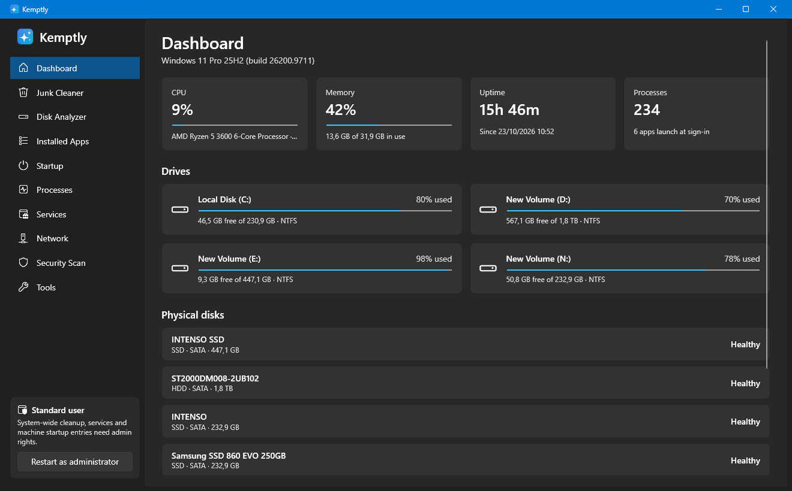
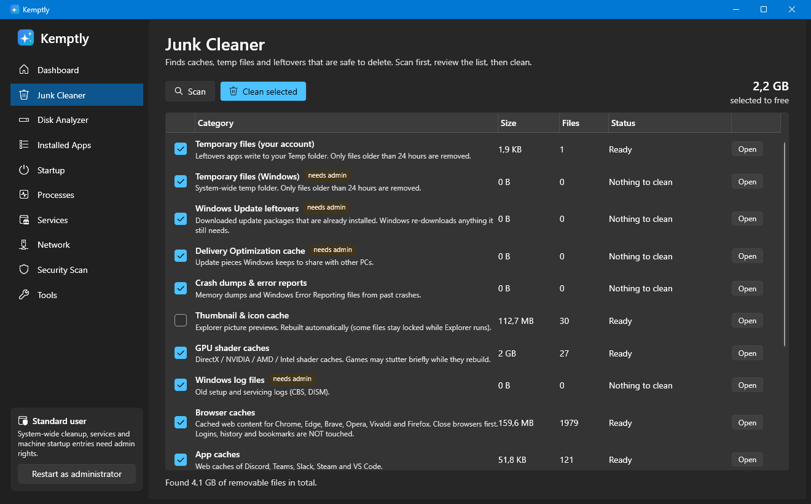
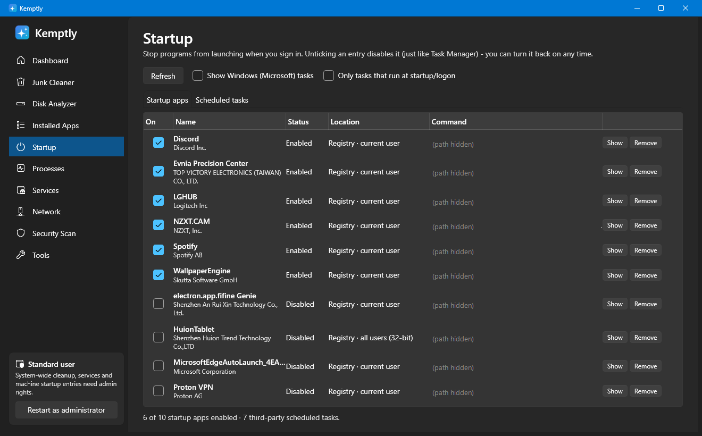
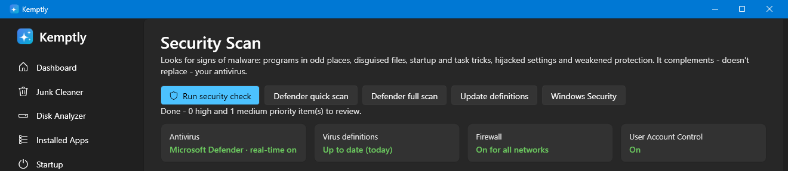
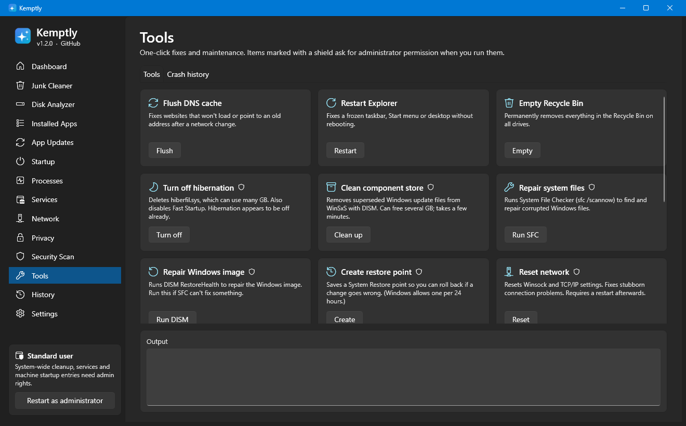

<div align="center">


# Kemptly

**Clean up, speed up and check your Windows 11 PC - all in one small, fast app.**

[](../../releases/latest)




</div>

---

## Features

| | |
|---|---|
| **Junk Cleaner** | Finds temp files, Windows Update leftovers, crash dumps, GPU shader caches, browser & app caches, developer caches and the Recycle Bin - then frees the space with one click. |
| **Disk Analyzer** | See which folders and file types fill your drive, list the largest files and delete them (to the Recycle Bin by default). |
| **Installed Apps** | Every desktop program with its size and install date - sort by size and uninstall what you don't use. |
| **Startup** | Stop apps and scheduled tasks from launching with Windows. Disabling is reversible and uses the same mechanism as Task Manager. |
| **Services** | Third-party background services at a glance; switch updaters and helpers to *Manual* or *Disabled*. |
| **Processes** | Live CPU and memory per app, grouped like Task Manager, with *End task*. |
| **Network** | Which programs are talking to the internet right now, with reverse-DNS host names and signature checks. |
| **Security Scan** | Heuristic checks for signs of malware (see below) plus one-click Microsoft Defender scans. |
| **Tools** | Flush DNS, restart Explorer, turn off hibernation, SFC / DISM repair, component-store cleanup, restore points, network reset, battery & energy reports. |

### What the security scan looks for

- Programs **impersonating Windows processes** (e.g. a `svchost.exe` outside `System32`)
- **Unsigned programs** running from Temp, Downloads, AppData roots or the Recycle Bin
- **Startup entries & scheduled tasks** that run encoded PowerShell, `mshta`, `rundll32`/`regsvr32` tricks or download tools
- **System hijacks**: Image File Execution Options debuggers, replaced Winlogon shell/Userinit, AppInit DLLs
- **Hosts file / proxy tampering** that redirects or blocks well-known sites
- **Disguised files** like `invoice.pdf.exe` or right-to-left filename tricks
- Status of **Defender, virus definitions, firewall and UAC**, plus Defender exclusions

> Kemptly complements your antivirus - it doesn't replace it.

## Screenshots

<table>
<tr>
<td></td>
<td></td>
</tr>
<tr>
<td align="center"><b>Junk Cleaner</b></td>
<td align="center"><b>Startup</b></td>
</tr>
<tr>
<td></td>
<td></td>
</tr>
<tr>
<td align="center"><b>Security Scan</b></td>
<td align="center"><b>Tools</b></td>
</tr>
</table>

## Install

1. Download **`Kemptly-Setup.msi`** from the [latest release](../../releases/latest).
2. Double-click it and follow the steps. No administrator rights needed - it installs just for your account.
3. Windows may show *"Windows protected your PC"* because the installer isn't code-signed: click **More info → Run anyway**.

Prefer no installer? Grab **`Kemptly-portable.exe`** from the same release and run it from anywhere.

**Uninstall:** *Settings → Apps → Installed apps → Kemptly → Uninstall.*

> Kemptly was called **WinTidy** in version 1.0. Installing Kemptly automatically replaces an existing WinTidy installation.

Some features (Windows temp / update cleanup, services, all-users startup entries) need admin rights - use **Restart as administrator** in the sidebar.

## Privacy & safety

- Everything runs locally. **No telemetry, no network calls** (apart from reverse-DNS lookups on the Network page and Defender's own updates).
- Nothing is changed or deleted until you click a button and confirm.
- Startup changes are reversible; large-file deletion goes to the Recycle Bin by default.

## Build from source

Requirements: Windows 10/11 and the [.NET 10 SDK](https://dotnet.microsoft.com/download).

```powershell
# Run the app
dotnet run --project Kemptly

# Build the installer → dist\Kemptly-Setup.msi (self-contained, no .NET needed on target PCs)
powershell -ExecutionPolicy Bypass -File build-installer.ps1 -Version 1.1.1
```

Releases are built automatically by GitHub Actions: push a tag like `v1.1.0` and the workflow attaches the MSI and portable exe to a new release.

Handy for shortcuts: `Kemptly.exe --page cleaner|disk|apps|startup|processes|services|network|security|tools [--scan]`

### Project layout

```
Kemptly/            WPF app (C#, .NET 10, Fluent theme)
  Core/             Cleaner, startup, services, network, security-scan logic
  Views/            One page per sidebar entry
  Assets/           Logo + make-icon.ps1 (regenerates the .ico)
Installer/          WiX v5 MSI project + make-art.ps1 (installer artwork)
build-installer.ps1 One-step publish + MSI build
```

## Security

See [SECURITY.md](SECURITY.md) for what Kemptly does and doesn't do, and how to report a vulnerability.

## License

[MIT](LICENSE) - free to use, modify and share. Provided "as is", without warranty.
